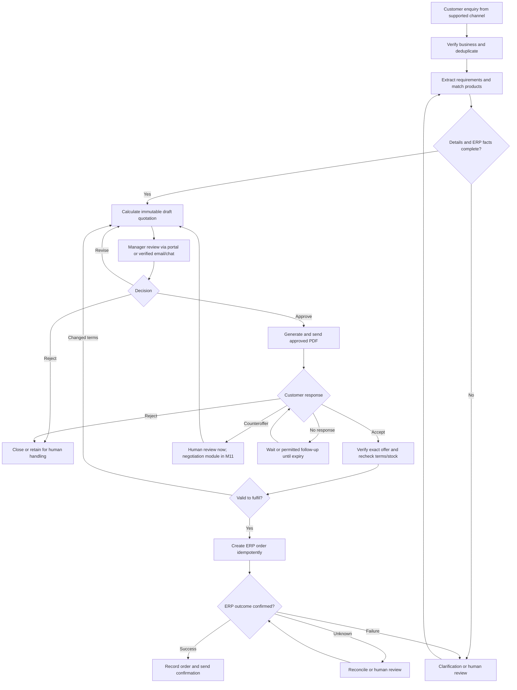
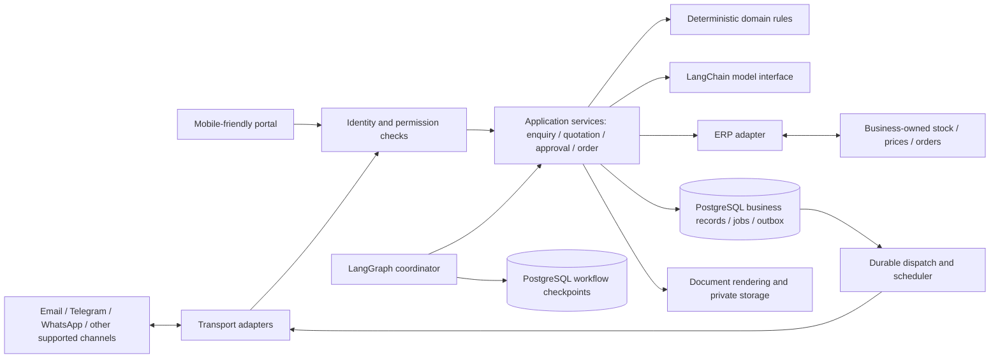
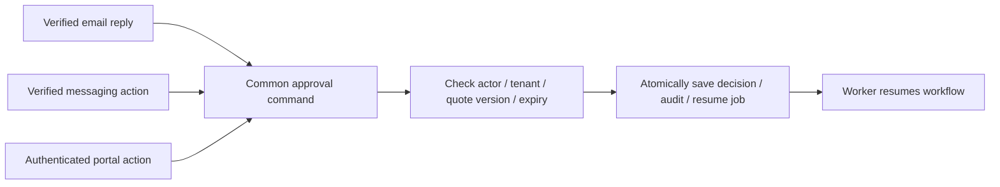
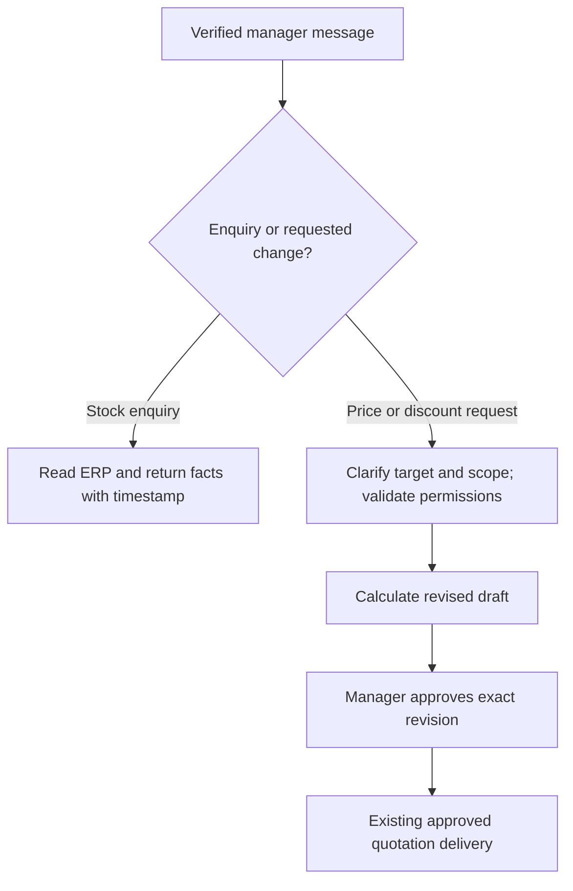

# System flowcharts
Status: planned behaviour. All application milestones remain pending.

## Business flow

Every revised negotiation offer returns to manager approval. A counteroffer is not customer acceptance. Not every failure is automatically retried; unrecoverable errors remain in human review.

## Module boundaries

Adapters handle provider differences. Application services own transactions and use cases. Domain rules own financial calculations. The workflow coordinates steps. See [module contracts](module-boundaries.md).

## One approval service for all channels

Provider verification and actor enrollment occur before submitting a command; the service independently checks current permissions. Replayed/conflicting decisions cannot approve a different version.

## Deferred manager commands

This last flow and negotiation are M11 features. Global catalogue changes require explicit separate scope and capability decisions.
