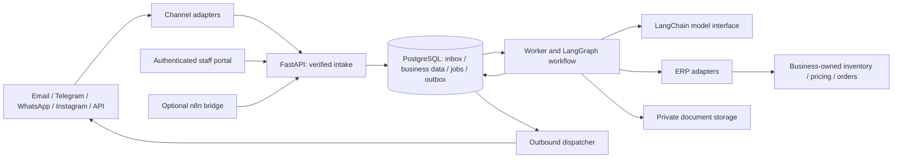

# System architecture
Status: planned. See [ADRs](../adr/README.md) for accepted design direction.

## Boundaries
A modular monolith means one versioned Python application with clearly separated modules. API, workflow worker and dispatcher/scheduler run as separate process roles from that codebase.

## Ownership
- API: authentication, tenant resolution, validation, durable event receipt, status and decision endpoints.
- Workflow: commercial process and branching; no provider-specific API payloads.
- Domain services: deterministic calculations and authorization/policy evaluation.
- Adapters: provider authentication, payload mapping, capability checks and normalized errors.
- PostgreSQL: durable business records, inbox/outbox/jobs and workflow checkpoints in separated schemas/permissions where supported.
- Worker: acquire leased jobs, serialize runs per workflow, execute bounded work and persist results.
- Scheduler: enqueue due follow-up/expiry/reconciliation work; no in-process multi-day sleeps.
- Dispatcher: execute approved outbound intents and record acknowledgements/delivery events.
- Portal: enquiries, exceptions, draft/approved quote versions, approval tasks, integrations and audit visibility.
- n8n: optional integration glue; core approvals, financial rules and workflow state stay in Python/PostgreSQL.

## Reliability contract
Inbound receipt and job creation share a database transaction. Business changes and outbox intents also share a transaction.
Graph checkpoint writes and business transactions are not assumed atomic together. Stable operation IDs and replay-safe nodes reconcile partial progress.
Delivery is at least once. Idempotency, constraints and reconciliation prevent repeated business effects where providers permit; do not claim universal exactly-once external execution.
No external network call is held inside a long DB transaction.
